## Objectifs

1. Décrire les relations entre Gouvernance, Conception, Développement, Validation, Déploiement et Opération de la sécurité, en restant au niveau de l'entreprise.
2. Montrer comment on aboutit à une PSSI depuis la gouvernance, sansxdétailler l'analyse de risques et l'audit de maturité.
3. Faire ressortir ce qui circule d'une étape à la suivante, et ce qui revient en arrière par l'amélioration continue.
4. Garder l'Opération peu détaillée, tout en y maintenant la boucle de retour.

Le modèle de référence est celui du cours : Gouverner → Concevoir → Réaliser → Valider → Déployer → Opérer → Améliorer. L'activité 9 en a détaillé trois étapes, Concevoir, Valider et Opérer. Ici je les replace dans l'ensemble et je regarde ce qui les relie.

## Identification des métiers pertinents

La gouvernance porte:

- La Direction Générale, qui valide et alloue les moyens.
- Le RSSI, qui rédige la PSSI et anime la déclinaison documentaire.
- Le chargé GRC conduit l'audit de maturité et l'analyse de risques.
- Le DPO et le service juridique veillent au cadre légal.

La conception revient à l'architecte sécurité et au Security Engineer, qui traduisent les directives en exigences et mènent le threat modeling.

Le développement est porté par les équipes logicielles et le spécialiste DevSecOps, qui branche les contrôles automatiques dans la CI/CD.

La validation revient à l'auditeur sécurité et au pentesteur. L'opération est assurée par le SOC, l'expert cyber-réponse et les administrateurs systèmes et réseaux.

## Déroulement

Je parcours les six étapes dans l'ordre du modèle et, pour chacune, je note ce qui s'y décide et ce qui en sort comme preuve. Je regarde ensuite ce qui doit circuler entre deux étapes consécutives, puis ce qui remonte en arrière par l'amélioration continue. L'Opération reste volontairement courte : le cours la développe au chapitre 1, et elle n'apparaît ici que comme source d'information pour les autres étapes.

## Résultats

### Les six étapes

| Étape | Ce qui s'y décide | Preuve de sortie |
|---|---|---|
| 1. Gouvernance | Le cadre : périmètre, référentiel, niveau de maturité visé, budget. Audit de maturité et analyse de risques (EBIOS RM au niveau entreprise, STRIDE-LM pour le volet technique) servent à écrire | PSSI signée par la Direction Générale, déclinée en standards, procédures, guidelines et baselines |
| 2. Conception | Ce que l'on protège et avec quelles mesures : exigences techniques, architectures, threat modeling, plan de tests | Dossier de conception, scénarios de risque qui justifient chaque mesure |
| 3. Développement | Le codage sécurisé et les contrôles automatiques dans la chaîne CI/CD | Code revu, rapports SAST et SCA, inventaire SBOM, pipeline qui bloque en cas d'écart |
| 4. Validation | La conformité et l'auditabilité : tests dynamiques, pentests, audits, collecte de preuves | Rapport d'audit, dossier de preuves, décision go / no-go |
| 5. Déploiement | La mise en production selon les configurations de référence et les contrôles d'accès | Procès-verbal de mise en production, écarts résiduels acceptés et datés |
| 6. Opération | Le quotidien : supervision, détection, réponse, continuité | Journaux et alertes, incidents qualifiés, retours d'expérience |

Deux points méritent d'être précisés. L'analyse de risques et l'audit de maturité n'apparaissent pas dans la PSSI, alors qu'ils l'ont produite : c'est le même point que j'ai traité dans l'activité 10. Et la conformité ne se confond pas avec l'auditabilité, on peut être conforme sur le papier avec des preuves insuffisantes.

### Vue d'ensemble

Le schéma donne la structure d'ensemble. Quatre groupes : le cadre de direction, le cycle de vie SSDLC, l'exploitation, et l'amélioration continue qui referme la boucle sur les étapes amont.

{#fig-schema-conception fig-alt="Six étapes de haut en bas. 1 Gouvernance : PSSI, audit de maturité, analyse de risques. 2 Conception : exigences, architectures, threat modeling. 3 Développement : codage sécurisé, CI/CD, SAST, SCA. 4 Validation : DAST, pentests, auditabilité. 5 Déploiement : hardening, contrôle d'accès. 6 Opération : SIEM, EDR, réponse à incident. L'Opération alimente en trait plein un bloc Amélioration continue, lui-même décliné en RETEX, veille et indicateurs. Ce bloc renvoie en trait pointillé vers la Gouvernance (révision de la PSSI, menaces et réglementations, priorités et moyens), la Conception (exigences à revoir), le Développement (tests de régression) et la Validation (écarts à corriger)."}

Le trait plein est le flux principal : une étape reçoit de la précédente et lui rend une preuve. Le trait pointillé est le retour, et il ne va que dans un sens, de l'amélioration continue vers les étapes amont. Le sens de lecture du diagramme est donc double : on descend le cycle, on remonte par le retour quand celui-ci se referme.

Aucune arête ne remonte le flux principal entre deux étapes, ce qui est la situation réelle : personne ne remonte le cycle. Le seul retour passe par l'amélioration continue.

### Ce qui circule entre les étapes

| De → vers | Ce qui doit circuler | Rupture fréquente |
|---|---|---|
| Gouvernance → Conception | Les règles de la PSSI et les exigences qu'elles portent | La conception démarre sur un besoin de projet, sans référence aux directives |
| Conception → Développement | Les exigences de sécurité, les règles de codage, les composants interdits | Le développement prend le dossier de conception comme une documentation, pas comme un contrat |
| Développement → Validation | Les artefacts à tester et le périmètre couvert par les tests | On teste ce qui est techniquement testable, pas ce qui était prévu |
| Validation → Déploiement | La décision go / no-go et les écarts restants, avec propriétaire et échéance | Le rapport d'audit reste un document, jamais une liste de tâches |
| Déploiement → Opération | La configuration de référence et les baselines | Les dérive de configuration en production ne sont pas surveillées |
| Opération → Améliorer | Les incidents, les alertes, les indicateurs, les presque-incidents | On ne compte que les incidents avérés, on perd les signaux faibles |

### Les boucles d'amélioration continue

L'amélioration continue ne se place pas à la fin du cycle, elle le referme sur lui-même. Quatre liens la portent.

| Lien | Ce qui le nourrit | Rupture fréquente |
|---|---|---|
| Opérer → Améliorer | RETEX après incident, indicateurs, veille | Aucun document de retour d'expérience n'est produit |
| Améliorer → Concevoir | Révision des architectures, des exigences, de l'analyse de risques | L'architecture initiale est reprise telle quelle |
| Améliorer → Valider | Retour d'expérience qui devient un test de régression | Le RETEX reste dans le rapport d'incident |
| Améliorer → Gouverner | KPI de performance et de maturité, révision de la PSSI | La PSSI est écrite une fois et jamais revue |

Le cycle PDCA joue donc aux deux niveaux : le SSDLC du développeur et le cycle de direction. Le RETEX alimente la révision des exigences, et l'audit de maturité peut être refait à partir des écarts constatés plutôt que sur la seule perception des métiers.

## Interprétation des résultats

STRIDE-LM et EBIOS RM ne jouent pas le même rôle, même s'ils servent tous deux à l'analyse des risques. EBIOS RM travaille au niveau de l'entreprise, sur les processus métiers et les événements redoutés. STRIDE-LM travaille sur les systèmes d'information, en déclinant les scénarios en menaces techniques. Le premier relève de la gouvernance, le second de la conception. Les employer au même endroit revient à confondre le risque métier et la vulnérabilité technique, qui se traitent par des personnes différentes et à des moments différents du cycle.

Les six étapes ne sont pas équivalentes en maturité. Valider est la plus outillée, Gouvernner et Déploiement dépendent d'un engagement de la direction, et Opérer est la plus sous-dotée en moyens alors qu'elle porte la charge quotidienne. L'asymétrie se retrouve dans les organisations : une politique bien écrite, peu de preuves d'application, une détection qui décroche après quelques mois.

Le maillon faible est le lien vers la gouvernance. Une alerte du SOC, un pentest ou une veille sur les vulnérabilités exploitées ne modifient pas une PSSI signée, parce que personne n'a la mission ni le droit de le faire. C'est aussi ce que je relève en activité 9 sur le lien Améliorer → Concevoir, et ce que je retrouve en activité 10 sur la mise à jour de la PSSI : la veille est le seul lien qui produit de l'information nouvelle, et c'est aussi celui qui se casse en premier.

L'obstacle n'est pas technique. Écrire une exigence ou relancer un écart demande quelques lignes dans un modèle de rapport ; corriger une analyse de risques suppose de la refaire, donc de rouvrir un document que la direction a validé. Tant que la PSSI est un engagement signé plutôt qu'une règle de travail révisable, les trois liens de retour restent des intentions.

Quatre indicateurs suffisent à rendre cette boucle discutable en comité de direction : la part de contrôles réellement couverts, le délai de correction d'un écart, le délai moyen de détection, et la part d'incidents qui aboutissent à un document de retour d'expérience. Ils disent si le cycle tourne, sans dépendre d'un taux de conformité global.

## Références

- slides-conception-entreprise.pdf, p. 56 et 57 (activité 11 ; modèle détaillé conception et opération de la sécurité, § 2.3).
- slides-conception-entreprise.pdf, p. 51 à 53 (PSSI, acteurs, exclusion de l'audit de maturité et de l'analyse de risques).
- slides-conception-entreprise.pdf, p. 54 et 55 (analyse des risques, EBIOS RM et STRIDE-LM ; audit de maturité).
- slides-intro.pdf, p. 39 (modèle conceptuel Gouverner → Concevoir → Réaliser → Valider → Déployer → Opérer → Améliorer).
- Corrigés du cours : organigramme.pdf et organigramme-general.pdf.
- NIST Cybersecurity Framework 2.0 : <https://www.nist.gov/cyberframework>
- ISO/IEC 27001:2022 (SMSI) et ISO/IEC 27002:2022 (bonnes pratiques).
- ANSSI, méthode EBIOS Risk Manager : <https://www.ebios.fr>
- OFCS : <https://www.ncsc.admin.ch/ncsc/fr/home.html>

## Utilisation IA

Reformulation des notes de cours et des diapositives, mise en place des tableaux, vérification de la cohérence entre les six étapes et aide pour le diagramme (code fournis).

Relecture orthographique et syntaxique.
