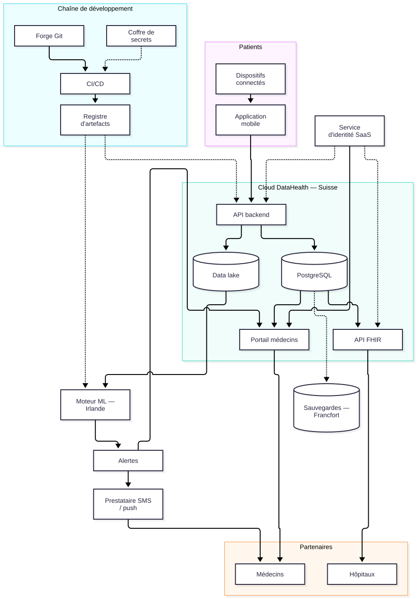
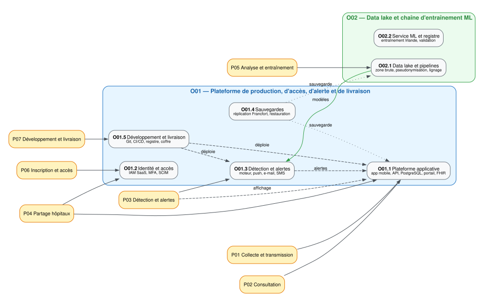

**Travail individuel**, Marc Pillonel. Entretien avec l'assistant-répondant lors de la séance A5 (semaine 43).

## Objectifs

1. Appliquer la MCSR simplifiée au cas DataHealth, sous forme d'audit, en m'arrêtant aux phases 1 à 4.
2. Identifier les processus et les objets informatiques à protéger, y compris la chaîne de développement.
3. Déterminer les besoins de protection et repérer les objets qui justifient une protection accrue.
4. Proposer des concepts de sécurité pour ces objets.
5. Donner des pistes pour un audit de maturité simple et une PSSI simplifiée.
6. Répondre à la question « Que faire ensuite ? ».

## Identification des métiers pertinents

Le cas fait intervenir des métiers du soin et de l'ingénierie :

- les médecins de ville, qui consultent les mesures et décident ;
- les équipes hospitalières, qui accèdent aux dossiers de leurs patients ;
- les ingénieurs data et ML, qui entraînent et valident les modèles ;
- les développeurs et le DevOps, qui livrent les évolutions ;
- le responsable réglementaire et qualité, qui porte la conformité et les preuves.

Les patients ne sont pas un métier de l'entreprise, mais ils produisent les mesures et subissent directement les conséquences d'une fuite ou d'une alerte manquée.

## Déroulement

Je travaille sur la fiche de la startup et sur les réponses de l'assistant-répondant pendant la séance A5. La fiche donne l'organisation, le périmètre, les objectifs et les écarts maximaux admissibles. L'entretien complète ce que le document ne dit pas, en particulier sur les fournisseurs et les preuves disponibles.

Je commence par le contexte réglementaire, parce qu'il fixe ce qui est admissible dans le domaine de la santé. J'enchaîne avec les processus, les objets informatiques, les besoins de protection et les concepts de sécurité. Je termine par l'audit de maturité, la PSSI et les actions à mener.

Je n'ai pas examiné les preuves documentaires : les statuts de l'audit restent des constats de pré-audit.

## Résultats

### Contexte spécifique et cadre réglementaire

DataHealth vend de la télésurveillance à distance à des patients chroniques : elle collecte des mesures à domicile, les rend accessibles aux médecins, détecte les anomalies, partage les dossiers avec les hôpitaux partenaires et livre les évolutions du produit. La plateforme relie environ 8 000 patients, 120 médecins et 6 hôpitaux partenaires ; les dispositifs et les smartphones des patients sortent du périmètre, mais les données qu'ils produisent y entrent. L'entreprise veut passer de 6 à 15 hôpitaux partenaires en 24 mois, ouvrir en France dans 12 mois et réussir une série A : la disponibilité, la confidentialité, la traçabilité et les preuves en découlent.

Le cadre réglementaire superpose plusieurs textes :

| Référentiel | Exigence clé | Impact sur l'analyse |
|---|---|---|
| nLPD (RS 235.1) | Données de santé = données sensibles (art. 5 let. c) ; finalité, minimisation, sécurité (art. 8) ; analyse d'impact (art. 22) ; annonce des violations (art. 24) ; transfert à l'étranger (art. 16) | P01 à P07 ; surtout P05 (data lake), P04 (hôpitaux) et P07 (environnements de développement) ; base légale, information des patients et contrats à documenter |
| Secret médical (art. 321 CP ; droit cantonal de la santé) | Révélation limitée aux personnes autorisées ; DataHealth intervient comme prestataire et auxiliaire des professionnels | P02, P04, P06 et P07 : cloisonnement, journalisation, contrats, sensibilisation, contrôle des changements |
| LDM/ODIm (RS 812.213) | Si le logiciel est un dispositif médical (SaMD) : SMQ ISO 13485, gestion des risques ISO 14971, cycle de vie IEC 62304, surveillance après commercialisation, vigilance | P03, P05 et P07 : validation des modèles, documentation, traçabilité, cycle de vie logiciel ; qualification à confirmer |
| RGPD (UE 2016/679) | Dès que l'entreprise cible le marché français : art. 9 (données de santé), 28 (sous-traitant), 32 (sécurité), 35 (AIPD), 44 (transferts) | P04, P05 et P07 ; gouvernance, contrats, information, minimisation dans les environnements de test |
| AI Act (UE 2024/1689) | Si l'IA est un système à haut risque (composant de sécurité d'un dispositif médical) : gouvernance des données, documentation, supervision humaine, robustesse ; application échelonnée | P03, P05 et P07 : documentation des modèles, des changements et des validations |
| MCSR ID 2.2, chaîne d'approvisionnement | Toutes les dépendances doivent être identifiées, évaluées selon leur importance et surveillées ; les fournisseurs SaaS et les accès privilégiés doivent être résilients | P01 à P07 ; surtout cloud, authentification, ML, SMS et forge Git/CI-CD ; contrats, preuves, plan de sortie |
| Exigences des acheteurs hospitaliers | ISO 27001, ISO 27799, SOC 2 ou ISAE 3402, clauses de sécurité, droit d'audit, localisation, réversibilité | P04, P06 et P07 : crédibilité, preuves de changement et due diligence de série A |

Les sauvegardes sont répliquées à Francfort et l'entraînement ML se fait en Irlande. Ces deux pays appartiennent à l'EEE et figurent sur la liste suisse des États offrant une protection adéquate : la localisation n'est pas, en soi, une violation de la nLPD. Restent à documenter la base légale, l'information des patients, le contrat de mandat, l'analyse d'impact et la pseudonymisation. La qualification de DataHealth dépend de la finalité (sous-traitant pour la consultation et le partage, responsable possible pour l'entraînement ML) et doit être clarifiée dans les contrats et la PSSI.

Je n'ai pas examiné les preuves cloud (contrats, rapports ISO 27001, SOC 2 ou ISAE 3402, configurations MFA, journaux). L'audit distingue donc les exigences partiellement satisfaites (P) des exigences non vérifiées (NV) : une preuve manquante n'est pas un mécanisme absent.

### Phase 1 : analyse des activités principales

#### 1.1 Identification des processus pertinents

Je retiens les processus indispensables aux objectifs stratégiques et économiques, ceux qui portent le service rendu. Cinq processus métier couvrent la chaîne de valeur. J'ajoute deux processus support critiques, P06 (inscription et gestion des accès) et P07 (développement et livraison de fonctionnalités), parce qu'ils conditionnent tous les autres. Le tableau sépare les processus des composants techniques : l'application mobile, l'API et le data lake sont des objets informatiques et relèvent de la phase 2.

| ID | Processus | Objectif principal | Objectifs secondaires | Écarts maximaux admissibles | Dépendances |
|---|---|---|---|---|---|
| P01 | Collecte et transmission des mesures | Mettre à disposition des médecins des mesures complètes, exactes et à jour, collectées depuis les dispositifs des patients | Confidentialité, intégrité, disponibilité de l'API, traçabilité de la source, conformité nLPD et secret médical, qualité (exhaustivité, délai) | Perte définitive de mesures ; altération non détectée d'une valeur ; indisponibilité de l'API de plus de 4 h | P06, dispositifs et réseau (hors périmètre) |
| P02 | Consultation des données par les médecins | Permettre au médecin de consulter l'état et l'historique de ses patients et de documenter sa décision clinique | Confidentialité et cloisonnement par patient et par médecin ; intégrité ; disponibilité pendant les heures ouvrables ; traçabilité des accès ; conformité (nLPD, secret médical) | Indisponibilité du portail de plus de 8 h ouvrables ; accès à un dossier hors de son périmètre | P01, P03, P06 |
| P03 | Détection d'anomalies et alertes | Détecter les anomalies cliniques et délivrer une alerte exploitable au médecin dans le délai requis | Sûreté clinique (pas de faux négatif critique) ; intégrité (alerte non falsifiée ou supprimée) ; disponibilité du moteur ; traçabilité (modèle, horodatage, destinataire, acquittement) ; conformité (dispositif médical, AI Act) | Alerte critique délivrée après plus de 5 min ; moteur indisponible plus de 30 min ; alerte falsifiée ou supprimée | P01, P05, P06 |
| P04 | Partage avec les hôpitaux partenaires | Permettre aux hôpitaux partenaires d'accéder aux dossiers des patients dont ils ont la charge, sans élargir leur périmètre | Cloisonnement inter-hôpitaux ; confidentialité ; traçabilité ; conformité (nLPD, secret médical, contrats) ; disponibilité (SLA contractuel à définir) ; intégrité | Accès d'un hôpital aux patients d'un autre ; divulgation de données identifiantes à un tiers non autorisé | P01, P02, P06 |
| P05 | Analyse et entraînement des modèles | Améliorer les modèles de détection à partir des données historiques, sans exposer les patients | Confidentialité (pseudonymisation) ; protection contre la réidentification ; intégrité des données et des modèles ; traçabilité (lignage, versions) ; conformité (nLPD, AI Act) ; maîtrise des transferts | Réidentification de personnes à partir du data lake | P01, P03, P06 |
| P06 | Inscription et gestion des accès (support critique) | Garantir que seules les personnes et organisations autorisées accèdent aux données et aux fonctions, avec le privilège nécessaire, et que ces accès sont révoqués en temps utile | Vérification de l'identité et du droit de pratique ; consentement et information ; authentification forte pour les comptes sensibles ; moindre privilège ; séparation des rôles (patient, médecin, hôpital, administrateur) ; traçabilité ; conformité ; disponibilité de l'authentification ; revue périodique | Création d'un compte sans vérification d'identité ou de droit de pratique ; accès à un dossier hors périmètre ; accès persistant après départ ou fin de contrat ; élévation de privilège non détectée ; absence de trace d'un accès sensible ; indisponibilité de l'authentification au-delà du seuil convenu | sert à P01-P05 et P07 |
| P07 | Développement et livraison de fonctionnalités (support critique) | Ajouter des fonctionnalités de manière contrôlée, testée, traçable et réversible, sans dégrader la sécurité, la conformité ou la sûreté clinique | Intégrité du code et des artefacts ; confidentialité des secrets ; disponibilité de la chaîne de livraison ; traçabilité (commits, revues, déploiements) ; conformité (IEC 62304, AI Act, nLPD) ; qualité | Déploiement en production d'un code non revu ou non testé ; fuite d'un secret ou d'une clé ; altération d'un artefact ou d'une dépendance ; déploiement non tracé ; impossibilité de rollback ou de corriger une vulnérabilité critique dans le délai requis | P06 (accès développeurs) ; P05 (modèles à déployer) ; fournisseur Git/CI-CD ; sauvegardes (O05) |

#### 1.2 Données de processus

| ID | Entrées et ressources | Étapes clés | Défaillances et résultats |
|---|---|---|---|
| P01 | Mesures (tension, glycémie, rythme), identité, horodatage ; app mobile (48 h), API Kubernetes, PostgreSQL, réseau | Capture → stockage local → transmission → validation → stockage → acquittement | Réseau absent, mémoire saturée, doublon, horloge dérivée, API indisponible, valeur corrompue → mesures disponibles, horodatées et rattachées au bon patient |
| P02 | Mesures, alertes, identité du médecin, périmètre ; portail SPA, API, authentification SaaS, PostgreSQL | Authentification → contrôle du périmètre → sélection du patient → affichage → journalisation | Session expirée, droits obsolètes, mauvaise sélection, portail indisponible → consultation tracée et décision clinique documentée |
| P03 | Mesures, modèles, seuils, médecin destinataire ; moteur ML, API, data lake, SMS, e-mail, push | Ingestion → score → comparaison au seuil → alerte → notification → acquittement | Faux négatif, faux positif, dérive du modèle, SMS retardé, alerte supprimée → alerte délivrée, acquittée et tracée |
| P04 | Dossiers, identité de l'hôpital, périmètre, contrat ; portail, API FHIR, authentification SaaS | Authentification → contrôle du périmètre → requête → réponse → journalisation | Mauvais périmètre, jeton expiré, droits persistants, fuite → dossier partagé dans le périmètre autorisé |
| P05 | Mesures, métadonnées, datasets pseudonymisés ; data lake, pipelines, service ML (Irlande), cloud | Extraction → pseudonymisation → entraînement → validation → déploiement | Réidentification, dataset corrompu, modèle non validé, fuite → modèle amélioré, versionné et validé |
| P06 | Identité, rôle, périmètre, contrat, droit de pratique, consentement, événements RH ; authentification SaaS, annuaire, portail, API | Demande → vérification → rôle et périmètre → provisioning → MFA → revue → révocation | Compte orphelin, rôle trop large, MFA absent, compte partagé, révocation tardive, annuaire obsolète → accès conforme, tracé et révocable |
| P07 | Code, tickets, configurations, secrets, dépendances, artefacts ; Git, CI/CD, runners, registre, coffre, staging | Branche → développement → revue → tests → build → analyse → staging → validation → production → rollback | Commit direct sur main, revue contournée, secret dans le code, dépendance compromise, artefact altéré, déploiement non tracé, rollback impossible, runner compromis → fonctionnalité livrée, testée, tracée et réversible |

L'inscription varie selon le profil : le patient vérifie son identité et consent, le médecin prouve son droit de pratique et son périmètre, l'hôpital signe un contrat et définit son tenant. Un défaut d'inscription se propage à P01 à P05 et à P07.

{#fig-processus width=90% fig-align="center" fig-alt="Diagramme de flux : patients et dispositifs connectés alimentent l'application mobile, l'API backend, PostgreSQL, le data lake, le portail médecins et l'API FHIR ; le moteur ML hébergé en Irlande produit les alertes ; les sauvegardes sont répliquées à Francfort ; le service d'identité SaaS contrôle les accès ; le prestataire SMS, les médecins, les hôpitaux et les partenaires sont reliés au cloud suisse ; la forge Git, la CI/CD, le coffre de secrets et le registre d'artefacts forment la chaîne de développement."}

La figure @fig-processus replace les composants décrits ci-dessus dans leur environnement : elle montre ce qui est hébergé en Suisse, ce qui sort du périmètre (dispositifs et smartphones des patients) et les dépendances externes (partenaires, prestataire SMS, service d'identité, forge Git).

#### 1.3 Solutions cloud et dépendances externes

Le cloud n'est pas un processus métier : je le traite comme une condition-cadre et une dépendance externe. Le fournisseur certifié ISO 27001 sécurise l'infrastructure, mais DataHealth reste responsable de la configuration, des identités, des données, des accès et des applications. La sécurité du cloud ne couvre pas la sécurité dans le cloud.

| Solution | Rôle / processus | Localisation | Preuve attendue |
|---|---|---|---|
| Cloud public de production | Héberge l'API, PostgreSQL, le portail et l'API FHIR (P01-P04) | Suisse | ISO 27001, SOC 2 ou ISAE 3402, DPA, preuve de chiffrement, plan de sortie |
| Sauvegardes répliquées | Sauvegarde et restauration (P01-P05, P07) | Francfort | DPA, chiffrement, journal et test de restauration |
| Service d'authentification SaaS | Authentification et fédération des identités (P02, P04, P06, P07) | À confirmer | ISO 27001 ou SOC 2, configuration MFA, journaux, DPA |
| Service ML managé | Entraînement des modèles (P05) | Irlande | DPA, preuve de pseudonymisation, analyse de réidentification |
| Prestataire SMS / push / e-mail | Envoi des alertes (P03) | À confirmer | DPA, modèle de message minimisé, journaux, SLA |
| Forge Git et CI/CD | Versionnement, builds, tests, déploiement (P07) | À confirmer | DPA, ISO 27001/SOC 2, branches protégées, coffre de secrets, plan de sortie |

Les points sensibles restent l'isolation des tenants, la gestion des clés, la journalisation et la réversibilité ; ils sont traités dans l'audit et la PSSI.

Je regroupe ces solutions en objets : O01 pour la plateforme de production sur le cloud suisse, O02 pour le data lake et la ML, O03 pour l'identité, O04 pour les alertes, O05 pour les sauvegardes et O06 pour le développement et la livraison. Le cloud reste une condition-cadre commune.

#### 1.4 Processus non retenus

Je ne retiens pas les processus support administratifs (RH, finance, facturation, support client, ventes) : ils ne portent pas la chaîne de valeur et restent couverts par les exigences GV et PR. Le support client, qui peut recevoir des données de santé, est rattaché à P02 et P04. En revanche, l'inscription (P06) et le développement (P07) deviennent des processus support critiques : ils conditionnent tous les accès et peuvent introduire des vulnérabilités ou des artefacts altérés en production. Au total, cinq processus métier et deux processus support critiques, ce qui reste raisonnable pour 17 personnes.

### Phase 2 : objets informatiques à protéger

Je pars des processus, puis j'agrège les composants qui remplissent une fonction commune. Je limite le nombre d'objets et j'évite qu'un même composant apparaisse dans plusieurs. Le cloud public reste une condition-cadre commune, pas un objet distinct. La chaîne de développement et de livraison forme O06 : elle remplit une fonction distincte et peut modifier O01, O02 et O04.

#### 2.1 Applications par processus

| Processus | Applications nécessaires | Rôle dans le processus |
|--|---|---|
| P01 | App mobile, API backend, PostgreSQL, service d'identité | Capture, transmission, stockage, authentification du patient |
| P02 | Portail web, API, PostgreSQL, service d'identité, moteur d'alertes | Consultation, affichage des alertes, contrôle d'accès |
| P03 | Moteur d'anomalies, API, service d'alerte (push/e-mail/SMS), service d'identité | Détection, notification, acquittement |
| P04 | Portail web, API FHIR, API, PostgreSQL, service d'identité | Partage contrôlé, cloisonnement inter-hôpitaux |
| P05 | Data lake, pipelines d'ingestion, service ML managé, registre de modèles | Entraînement, validation, versionnement |
| P06 | Service d'identité SaaS, annuaire, portail/API d'administration | Inscription, provisioning, revue, révocation |
| P07 | Forge Git, CI/CD, registre d'artefacts, coffre de secrets, staging | Versionnement, revue, build, tests, déploiement, rollback |

: Tableau des processus {.tbl-colwidths="[12,44,44]"}

#### 2.2 Objets informatiques à protéger (phase 2)

| ID | Nom | Description / plateformes | Processus servis | Composants principaux | Données et flux | Personnes / groupes | Conditions-cadres (fournisseurs, localisation) |
|---|---|---|---|---|---|---|---|
| O01 | Plateforme de production et application mobile | App mobile iOS/Android (stockage local 48 h) ; API REST sur Kubernetes managé ; PostgreSQL managé ; portail web SPA ; API FHIR. Cloud public ISO 27001 en Suisse ; pas de centre de données propre. | P01, P02, P03 (affichage/acquittement), P04 | App mobile ; API REST ; PostgreSQL ; portail SPA ; API FHIR ; Kubernetes ; journaux | Entrées : mesures, identités, requêtes médecins/hôpitaux ; sorties : dossiers, alertes, flux FHIR ; données : mesures, dossiers patients, identités, journaux | Patients ; médecins ; hôpitaux ; administrateurs ; support | Cloud public ISO 27001 (Suisse) ; contrats hôpitaux ; nLPD ; secret médical ; dépendance O03 |
| O02 | Data lake et chaîne d'entraînement ML | Stockage objet + pipelines d'ingestion + pseudonymisation + service ML managé (Irlande) + registre de modèles. Data lake en Suisse ; entraînement en Irlande. | P05 ; alimente P03 | Data lake ; pipelines ; pseudonymisation ; service ML managé ; registre de modèles ; jeux de données | Entrées : mesures et métadonnées de P01 ; sorties : modèles vers O04 ; données : datasets pseudonymisés, modèles, journaux | Ingénieurs data/ML ; responsable réglementaire/qualité ; administrateurs | Cloud Suisse ; service ML Irlande (UE) ; nLPD art. 16 ; AI Act ; contrats ; pseudonymisation à vérifier |
| O03 | Service d'identité et d'accès (IAM) | SaaS d'authentification et de fédération pour employés, médecins et hôpitaux ; MFA ; provisioning ; journaux. Localisation à confirmer. | P06 ; P01, P02, P04, P07 | Service d'authentification SaaS ; annuaire ; MFA ; provisioning/SCIM ; portail d'administration ; journaux | Entrées : inscriptions, rôles, périmètres, événements RH, contrats ; sorties : jetons, assertions, journaux ; données : identités, credentials, rôles, logs | Patients ; médecins ; hôpitaux ; employés ; administrateurs | SaaS tiers (localisation à confirmer) ; contrat ; ISO 27001/SOC 2 ; nLPD ; secret médical |
| O04 | Détection et chaîne d'alerte | Moteur d'anomalies en production ; service d'alerte ; notification push, e-mail et SMS via prestataire tiers. Cloud Suisse + prestataire SMS. | P03 ; affichage/acquittement via O01 | Serving du modèle ; moteur d'alerte ; push ; e-mail ; SMS ; files d'attente ; journaux | Entrées : mesures de O01, modèles de O02 ; sorties : alertes vers médecins et portail ; données : scores, alertes, acquittements, numéros | Médecins ; patients ; administrateurs ; prestataire SMS | Dispositif médical (à confirmer) ; AI Act ; prestataire SMS (localisation à confirmer) ; délai de 5 min |
| O05 | Sauvegardes et restauration | Stockage de sauvegarde répliqué à Francfort ; politiques de rétention ; tests de restauration. Cloud Allemagne. | P01 à P05 et P07 | Stockage objet ; réplication ; chiffrement ; outil de restauration ; journaux | Entrées : copies de O01, O02, O03 et O06 ; sorties : restauration ; données : données de santé, configurations, bases, dépôts et artefacts | DevOps/SRE ; administrateurs ; CTO | Cloud Allemagne (UE) ; nLPD art. 16 ; contrat ; chiffrement ; test de restauration |
| O06 | Chaîne de développement et de livraison | Forge Git ; pipelines CI/CD ; registre d'artefacts ; coffre de secrets ; staging. Cloud/SaaS à confirmer ; pas de données de production en clair. | P07 ; contribue à P01-P04 via les déploiements | Forge Git ; runners CI/CD ; tests automatisés ; registre d'artefacts ; coffre de secrets ; staging ; journaux | Entrées : code, configurations, secrets ; sorties : builds, images, déploiements ; données : code source, artefacts, secrets, journaux | Développeurs ; DevOps/SRE ; CTO ; administrateurs | SaaS/cloud (localisation à confirmer) ; contrats ; ISO 27001/SOC 2 ; nLPD ; séparation dev/prod |

Je vérifie que chaque composant est rattaché à un objet : collecte, consultation et partage vont dans O01 ; le data lake et l'entraînement dans O02 ; l'identité dans O03 ; le serving et les alertes dans O04 ; les sauvegardes dans O05 ; le développement et la livraison dans O06. L'entraînement et le serving restent séparés : le modèle est un flux, pas un composant partagé. Le cloud reste une condition-cadre commune. Le service d'identité n'apparaît que dans O03, et les autres objets en dépendent. O06 ne contient pas de données de production, seulement du code, des artefacts et des secrets. Six objets pour 17 personnes et sept processus, c'est raisonnable. Si je voulais traiter les risques propres aux téléphones des patients, je détacherais l'application mobile en O07.

**Aspects physiques.** DataHealth n'a pas de centre de données. Les aspects physiques pertinents sont les locaux et les postes des administrateurs et des développeurs, les smartphones des patients (hors périmètre), les data centers des fournisseurs (couverts par ISO 27001) et les runners CI/CD, hébergés dans le cloud. Les sauvegardes sont répliquées à Francfort et aucun support physique n'est transporté.

{#fig-objets width=90% fig-align="center" fig-alt="Graphe des objets : P01 Collecte et P02 Consultation portées par O01 Plateforme de production ; P04 Partage par O01 et O03 Identité et accès ; P06 Inscription par O03 ; P05 Analyse et entraînement par O02 Data lake et ML ; P03 Détection et alertes par O04 ; P07 Développement et livraison par O06 ; O05 Sauvegardes reçoit les flux de O01, O02 et O06 ; O06 déploie vers O01, O02 et O04."}

La figure @fig-objets montre l'agrégation retenue : un processus peut être porté par plusieurs objets, mais chaque composant n'appartient qu'à un seul objet. Les flèches « déploie » matérialisent le point de concentration que représente O06.

### Phase 3 : besoins de protection

Un besoin de protection accru apparaît lorsque les exigences fondamentales ne suffisent pas à éviter un écart non admissible. La consigne demande un ou deux objets ; j'en retiens trois, O02 (data lake et ML), O04 (détection et alertes) et O06 (développement et livraison). Un code non revu, un secret exposé ou un artefact altéré peut modifier O01, O02 et O04 en même temps. O01, O03 et O05 ont aussi des écarts non admissibles, mais les exigences fondamentales les couvrent si elles sont mises en œuvre.

| Objet | Objectif concerné | Événement inacceptable | Écart non admissible ? | Besoin accru ? | Exigences fondamentales de référence | Justification |
|---|---|---|---|---|---|---|
| O01 | Confidentialité, intégrité, disponibilité, traçabilité | Accès à un dossier hors périmètre ; divulgation à un tiers non autorisé ; altération non détectée d'une mesure ; API indisponible > 4 h ; portail indisponible > 8 h ouvrables ; absence de trace d'accès | Oui : écarts P01, P02 et P04 | Non (protection de base suffisante) | PR 3.1, PR 3.3, PR 3.4, PR 3.6, PR 3.9, DE 4.1 | Les exigences fondamentales PR 3.1 (durcissement), PR 3.3 (accès), PR 3.4 (segmentation réseau), PR 3.6 (chiffrement et intégrité), PR 3.9 (disponibilité) et DE 4.1 (journalisation) couvrent ces objectifs, à condition d'être pleinement mises en œuvre. O01 dépend de O03, O05 et O06. Aucune MTO supplémentaire identifiée. |
| O02 | Confidentialité, intégrité, traçabilité | Réidentification de personnes à partir du data lake ; fuite de datasets pseudonymisés ; modèle altéré ; perte de lignage | Oui : réidentification (P05) | **Oui (MTO supplémentaires)** | ID 2.2, PR 3.2, PR 3.3, PR 3.5, PR 3.6, PR 3.8, DE 4.1 | La réidentification est un écart non admissible. Les exigences de base (PR 3.3, PR 3.6) ne suffisent pas : il faut des MTO supplémentaires de pseudonymisation, de test de réidentification, de cloisonnement et de lignage. |
| O03 | Confidentialité, intégrité, disponibilité, traçabilité | Vol de credentials ; prise de contrôle de compte ; élévation de privilège ; accès hors périmètre ; indisponibilité de l'authentification | Oui : accès hors périmètre (P02, P04) | Non (protection de base suffisante) | PR 3.1, PR 3.3, PR 3.4, DE 4.1, RS/RC 5.2 | PR 3.3 (authentification, moindre privilège) couvre l'objectif ; MFA, RBAC et revue des accès font partie de la mise en œuvre du besoin de protection. O03 est une dépendance critique de O01 et O06, mais ne nécessite pas de MTO supplémentaire. |
| O04 | Confidentialité, intégrité, disponibilité, traçabilité | Alerte critique délivrée > 5 min ; moteur indisponible > 30 min ; alerte falsifiée ou supprimée ; contenu d'alerte divulgué au prestataire SMS | Oui : écarts P03 | **Oui (MTO supplémentaires)** | PR 3.1, PR 3.3, PR 3.4, PR 3.6, PR 3.9, DE 4.1, RS/RC 5.1, RS/RC 5.3 | La sûreté clinique, le délai de 5 min et l'intégrité des alertes dépassent la protection de base : il faut des MTO supplémentaires (redondance, acquittement, intégrité de bout en bout, surveillance du modèle, minimisation du contenu). |
| O05 | Confidentialité, intégrité, disponibilité | Fuite de sauvegardes ; sauvegarde corrompue ; restauration impossible | Oui : perte ou altération de données, indisponibilité | Non (protection de base suffisante) | PR 3.1, PR 3.6, PR 3.7, RS/RC 5.2 | PR 3.7 (sauvegarde, restauration, tests) et PR 3.6 (chiffrement) couvrent l'objectif. O05 est une dépendance critique de O01, O02 et O06, mais ne nécessite pas de MTO supplémentaire au-delà de la protection de base. |
| O06 | Confidentialité, intégrité, disponibilité, traçabilité | Injection de code malveillant en production ; fuite de secrets ; altération d'un artefact ; déploiement non tracé ; compromission d'un runner ; rollback impossible | Oui : un code non revu peut altérer P01, fausser P03 ou exposer des données (P04) | **Oui (MTO supplémentaires)** | PR 3.1, PR 3.2, PR 3.3, PR 3.5, PR 3.6, PR 3.8, DE 4.1, RS/RC 5.2 | La chaîne de développement peut modifier simultanément O01, O02 et O04. PR 3.8 (développement sécurisé) fournit le cadre, mais ne suffit pas à lui seul : il faut des MTO supplémentaires de revue, de protection des secrets, d'intégrité des artefacts, d'isolation des runners et de rollback. |
: Besoins de protection par objet {.small}

**Conclusion.** Trois objets justifient donc une protection accrue. Pour O01, O03 et O05, la priorité n'est pas d'ajouter des mesures, mais de prouver et de compléter la protection de base : l'audit montre qu'elle n'est pas démontrée (E05 pour les accès, E06 pour le chiffrement, E15 pour le durcissement). Sans O06, le point de concentration de la chaîne de développement resterait sans mesures supplémentaires.

### Phase 4 : concept de sécurité

Je m'appuie sur l'annexe C pour O01, O03 et O05. Pour O02, O04 et O06, les tableaux ci-dessous définissent les MTO supplémentaires.

**O02 : data lake et chaîne d'entraînement ML**

| Écart non admissible à éviter | MTO supplémentaire | Mise en œuvre (comment, qui, quand) | Preuve / indicateur |
|---|---|---|---|
| Réidentification à partir du data lake | Pseudonymisation renforcée et séparation des identifiants ; test de réidentification (k-anonymat, quasi-identifiants) avant chaque dataset | Data/ML + DPO ; avant chaque entraînement ; revue trimestrielle | Rapport de test de réidentification ; registre des datasets |
| Fuite de datasets pseudonymisés | Cloisonnement du data lake (compte séparé, réseau, IAM) ; chiffrement avec clés gérées par DataHealth ; accès juste-à-temps | CTO/DevOps + Data/ML ; 3 mois ; revue trimestrielle | Schéma de cloisonnement ; logs d'accès ; preuve de chiffrement |
| Modèle altéré ou perte de lignage | Registre des modèles et des datasets ; journal immuable ; validation avant déploiement ; séparation entraînement/production | Data/ML + qualité ; à chaque version ; revue trimestrielle | Registre ; journal ; rapport de validation |
| Accès non autorisé aux données d'entraînement | MFA, RBAC, moindre privilège, revue des accès ; contrat avec le service ML (Irlande) | CTO + DPO ; 3 mois ; revue trimestrielle | Configuration MFA/RBAC ; DPA ; revue des accès |
: Concept de sécurité de O02 {.small}

**O04 : détection et chaîne d'alerte**

| Écart non admissible à éviter | MTO supplémentaire | Mise en œuvre (comment, qui, quand) | Preuve / indicateur |
|---|---|---|---|
| Alerte critique > 5 min | Redondance des canaux (push + e-mail + SMS) avec bascule automatique ; file persistante ; mesure de latence de bout en bout | CTO/DevOps + astreinte ; 3 mois ; tests mensuels | Tableau de bord de latence ; test de bascule |
| Moteur indisponible > 30 min | Redondance du serving ; supervision ; plan de continuité ; mode dégradé manuel | CTO/DevOps ; 3 mois ; test trimestriel | Plan de continuité ; rapport de test |
| Alerte falsifiée ou supprimée | Signature/HMAC des alertes ; journal immuable ; contrôle de version du modèle ; double validation pour les alertes critiques | Data/ML + DevOps ; 3 mois ; revue trimestrielle | Journal d'intégrité ; registre des modèles ; procédure |
| Contenu d'alerte divulgué au prestataire SMS | Minimisation du contenu (pas de nom complet, pas de diagnostic) ; chiffrement ; DPA ; clauses de confidentialité | CTO + DPO ; 1 mois ; revue annuelle | Modèle de message ; DPA ; configuration |
: Concept de sécurité de O04 {.small}

**O06 : chaîne de développement et de livraison**

| Écart non admissible à éviter | MTO supplémentaire | Mise en œuvre (comment, qui, quand) | Preuve / indicateur |
|---|---|---|---|
| Injection de code malveillant ou non revu en production | Git avec branches protégées ; revue obligatoire ; commits signés ; séparation des rôles auteur/relecteur ; déploiement uniquement via CI/CD | CTO/DevOps + développeurs ; 3 mois ; à chaque changement | Configuration des branches ; historique des revues ; journal des déploiements |
| Fuite de secrets ou de clés | Coffre de secrets ; aucune clé dans le code ; rotation ; scan de secrets ; accès juste-à-temps | CTO/DevOps ; 1 mois ; rotation trimestrielle | Inventaire des secrets ; configuration du coffre ; rapport de scan |
| Altération d'un artefact ou d'une dépendance | Registre d'artefacts ; signature des images ; analyse des dépendances (SCA) ; verrouillage des versions ; provenance des builds | DevOps + Data/ML ; 3 à 6 mois ; à chaque build | Rapport SCA ; signatures ; provenance ; registre |
| Compromission d'un runner ou d'un pipeline | Isolation des runners ; moindre privilège ; pas de secrets en clair ; journaux CI/CD ; alertes | DevOps ; 3 mois ; revue trimestrielle | Configuration des runners ; logs ; alertes |
| Déploiement non tracé ou rollback impossible | Journal des déploiements ; versionnement ; procédure de rollback testée ; environnement de staging | DevOps ; 3 mois ; test trimestriel | Journal ; procédure ; rapport de test |
: Concept de sécurité de O06 {.small}

### Phase 5 : mise en œuvre (non traitée)

Je ne traite pas l'étape 5 (mise en œuvre, surveillance opérationnelle et amélioration permanente des MTO), conformément à la consigne.

### Audit de maturité simple

Je fais un pré-audit sur les informations disponibles : les statuts NV restent à lever avec le tableau « mesures existantes et preuves » du répondant, et je n'affirme aucun finding sans preuve. J'examine les 20 exigences de l'annexe C ; GV 1.2 et ID 2.1 ne s'appliquent pas avec la MCSR et restent en NP pour que le dénominateur soit explicite.

Statuts : **S** satisfait, **P** partiellement satisfait, **NS** non satisfait, **NV** non vérifié, **NP** non pertinent.
Types de preuve : **D** document, **C** configuration ou capture d'écran, **J** journal, **E** entretien (preuve faible), **A** aucune.

::: {.table-scroll}
| ID | Famille | Réf. annexe C | Exigence (résumé) | Applic. | Objet(s) | Accru | Mécanisme existant | Constat | Preuve (type) | Statut | Écart / MTO proposée | Priorité |
|---|---|---|---|---|---|---|---|---|---|---|---|---|
| E01 | GV | GV 1.1 | Organisation de la sécurité | O | Tous | N | O | Pas de responsable sécurité désigné ; le CTO gère de fait ; rôles non formalisés | E (entretien) | P | Désigner un responsable sécurité, formaliser les rôles et la communication | 1 |
| E02 | GV | GV 1.4 | Formation et sensibilisation | O | Tous | N | N | Aucune information sur les formations | A | NV | Programme de sensibilisation annuel, preuves de participation | 2 |
| E03 | ID | ID 2.2 | Chaîne d'approvisionnement | O | O01-O06 | O | O | Cloud ISO 27001 reçu ; preuves DPA, SOC 2 et contrats auth, SMS, ML, forge Git à obtenir | D (rapport ISO 27001) | P | Inventaire fournisseurs, DPA, preuves, plan de sortie | 1 |
| E04 | PR | PR 3.2 | Gestion des faiblesses et vulnérabilités | O | O01-O06 | O | N | Pas de preuve de veille, de scan de dépendances ni de gestion des correctifs | A | NV | Inventaire, veille CVE, SCA, gestion des correctifs | 2 |
| E05 | PR | PR 3.3 | Identités et contrôles d'accès | O | O01-O06 | O | O | Auth SaaS présente ; MFA, moindre privilège et revue des accès non démontrés ; accès à la forge à vérifier | E, C à obtenir | NV | MFA, RBAC, revue trimestrielle, journalisation | 1 |
| E06 | PR | PR 3.6 | Cryptage et suppression des données | O | O01-O06 | O | O | Chiffrement non documenté ; suppression non prouvée | A | NV | Chiffrement au repos et en transit, gestion des clés, politique de suppression | 2 |
| E07 | PR | PR 3.7 | Sauvegarde des données | O | O05, O06 | N | O | Réplication à Francfort ; restauration non testée ; sauvegarde des dépôts et artefacts à confirmer | D (fiche), test de restauration à obtenir | P | Tests de restauration, sauvegarde des dépôts et artefacts, journal, RTO/RPO | 2 |
| E08 | PR | PR 3.8 | Développement | O | O01, O02, O04, O06 | O | N | Pas d'information sur Git, branches, revue, CI/CD, secrets, séparation dev/prod | A | NV | Git avec branches protégées, revue, commits signés, CI/CD isolé, coffre de secrets, SAST/DAST, séparation dev/prod, signature des artefacts | 2 |
| E09 | PR | PR 3.9 | Disponibilité | O | O01-O04 | O | O | Redondance et capacités non documentées ; QoS 95 % non prouvée | A | NV | Architecture redondante, tests de charge, RTO/RPO | 2 |
| E10 | DE | DE 4.1 | Enregistrement et surveillance | O | O01-O06 | O | N | Journaux non documentés ; pas de surveillance centralisée ; logs CI/CD à vérifier | A | NV | Centralisation des logs (y compris CI/CD), alertes, rétention | 1 |
| E11 | DE | DE 4.2 | Annonce | O | O01-O06 | N | N | Aucune preuve de canal de signalement ; à vérifier | A | NV | Vérifier l'existence ; sinon, security.txt et une procédure de signalement | 3 |
| E12 | RS/RC | RS/RC 5.1 | Gestion des incidents | O | Tous | O | N | Aucune preuve de procédure documentée ; à vérifier ; inclure la compromission CI/CD | A | NV | Vérifier l'existence ; sinon, procédure, astreinte et notification nLPD art. 24 | 1 |
| E13 | RS/RC | RS/RC 5.2 | Planification d'urgence | O | O01-O06 | O | N | Aucune preuve de PCA/PRA ni de test ; rollback CI/CD à documenter | A | NV | Vérifier l'existence ; sinon, PCA/PRA, tests, rollback et communication | 1 |
| E14 | GV | GV 1.3 | Contrôle du personnel | O | Tous | N | N | Pas d'information sur les vérifications | A | NV | Vérification des antécédents selon le rôle | 3 |
| E15 | PR | PR 3.1 | Protection physique, configuration et exploitation | O | O01-O06 | O | O (partiel) | Pas de centre de données propre : la protection physique est couverte par le fournisseur ISO 27001 ; le durcissement des images, des postes et des runners n'est pas documenté | D (rapport ISO 27001) + A | P | Durcissement (référentiel CIS), images de base, registre des configurations, postes chiffrés | 2 |
| E16 | PR | PR 3.4 | Sécurité du réseau | O | O01-O06 | O | N | Segmentation, filtrage et exposition de PostgreSQL et de l'API non documentés | A | NV | Segmentation, API gateway ou WAF, aucune base exposée directement à Internet | 2 |
| E17 | PR | PR 3.5 | Protection contre les logiciels malveillants | O | O01, O02, O06 | O | N | EDR ou antivirus des postes et des runners non documenté ; les dispositifs des patients sont hors périmètre | A | NV | EDR sur les postes et les serveurs, analyse des artefacts | 3 |
| E18 | RS/RC | RS/RC 5.3 | Communication | O | Tous | O | N | Rôles et canaux de communication de crise non documentés | A | NV | Plan de communication, porte-parole, canaux, modèles de message | 2 |
| E19 | GV | GV 1.2* | Gestion des cyberrisques | N | - | - | - | Non applicable : exigence marquée d'un astérisque dans l'annexe C ; la MCSR remplace l'analyse de risques | - | NP | - | - |
| E20 | ID | ID 2.1* | Objets informatiques à protéger | N | - | - | - | Non applicable : exigence marquée d'un astérisque ; le travail est fait en phase 2 | - | NP | - | - |
: Pré-audit des 20 exigences fondamentales {.small tbl-colwidths="[4,5,7,13,4,7,4,5,19,7,4,16,4]"}
:::

La colonne « Accru » indique si l'exigence compte pour au moins un objet à protection accrue (O02, O04, O06).

#### Indicateurs

Avec N = 20 exigences examinées, A = 18 applicables, S = 0, P = 4, NS = 0, NV = 14, NP = 2 :

| Indicateur | Formule | Valeur |
|---|---|---|
| Exigences applicables | A / N | 90 % |
| Applicables satisfaites ou partiellement satisfaites | (S + P) / A | 22 % |
| Applicables pleinement satisfaites | S / A | 0 % |
| Mécanismes existants avec écart ou preuve incomplète | mécanisme O et statut P ou NV | 7 (39 % de A) |
: Indicateurs de maturité {.small}

Ces chiffres restent provisoires : la plupart des NV signalent une preuve manquante, pas une absence de mécanisme.

#### Répartition par famille

| Famille | S | P | NS | NV | NP | Total |
|---|---|---|---|---|---|---|
| GV | 0 | 1 | 0 | 2 | 1 | 4 |
| ID | 0 | 1 | 0 | 0 | 1 | 2 |
| PR | 0 | 2 | 0 | 7 | 0 | 9 |
| DE | 0 | 0 | 0 | 2 | 0 | 2 |
| RS/RC | 0 | 0 | 0 | 3 | 0 | 3 |
| **Total** | **0** | **4** | **0** | **14** | **2** | **20** |
: Répartition par famille MCSR {.small}

#### Répartition pour les objets à protection accrue

La répartition porte sur les exigences citées dans la colonne « Exigences fondamentales de référence » de la phase 3. Une exigence peut concerner plusieurs objets ; elle est comptée pour chacun.

| Objet | S | P | NS | NV | NP | Total |
|---|---|---|---|---|---|---|
| O02 | 0 | 1 | 0 | 6 | 0 | 7 |
| O04 | 0 | 1 | 0 | 7 | 0 | 8 |
| O06 | 0 | 1 | 0 | 7 | 0 | 8 |
: Répartition pour O02, O04 et O06 {.small}

Pour O02, les exigences retenues sont E03, E04, E05, E06, E08, E10 et E17. Pour O04 : E05, E06, E09, E10, E12, E15, E16 et E18. Pour O06 : E04, E05, E06, E08, E10, E13, E15 et E17. Une exigence transverse n'est comptée que pour les objets dont la liste de référence la cite : E01, E02, E11 et E14 ne sont comptées pour aucun des trois, et E12 seulement pour O04.

#### Mesures prioritaires

::: {.table-scroll}
| Priorité | MTO | Écart traité | Objet(s) | Famille | Effort | Responsable | Échéance | Preuve |
|---|---|---|---|---|---|---|---|---|
| 1 | Désigner un responsable sécurité et formaliser les rôles | GV 1.1 | Tous | GV | S | CEO/CTO | 1 mois | Fiche de fonction, organigramme, communication |
| 2 | MFA, RBAC, revue trimestrielle des accès | PR 3.3 | O01-O06 | PR | M | CTO/DevOps | 3 mois | Configuration, logs, comptes rendus de revue |
| 3 | Sécuriser la chaîne de développement (Git, revue, CI/CD, secrets, séparation dev/prod) | PR 3.8 | O01, O02, O04, O06 | PR | M | CTO/DevOps | 3 mois | Branches protégées, revues, logs CI, coffre de secrets, preuve de séparation |
| 4 | Inventaire fournisseurs, DPA, preuves ISO 27001/SOC 2 | ID 2.2 | O01-O06 | ID | M | CTO/achats | 3 mois | Registre, contrats, rapports |
| 5 | Détection et réponse : journalisation centralisée, alertes, procédure d'incident et notification nLPD | DE 4.1, RS/RC 5.1 | Tous | DE, RS/RC | M | DevOps/CTO/DPO | 3 mois | Logs, tableau de bord, procédure, test, registre |
| 6 | PCA/PRA, tests de restauration et rollback | RS/RC 5.2, PR 3.7 | O01-O06 | RS/RC | M | CTO/DevOps | 6 mois | Plan, rapport de test, RTO/RPO, procédure de rollback |
| 7 | Pseudonymisation renforcée et tests de réidentification | O02 | O02 | PR/DE | M | Data/ML + DPO | 3 mois | Rapport de test, registre |
| 8 | Redondance des alertes et mesure de latence | O04 | O04 | PR/DE | M | CTO/DevOps | 3 mois | Tableau de bord, test de bascule |
: Mesures prioritaires {.small tbl-colwidths="[5,24,12,10,7,5,10,7,20]"}
:::

Le durcissement (E15), la segmentation réseau (E16) et la protection contre les malwares (E17) restent en priorité 2 ou 3. Ils figurent dans le tableau d'audit et dans la PSSI (chapitre 7) sans entrer dans les huit mesures prioritaires.

### PSSI simplifiée

**PSSI de DataHealth SA, version 0.1**

| Élément | Valeur |
|---|---|
| Titre | Politique de sécurité des systèmes d'information |
| Version / date | 0.1 / 23 octobre 2026 |
| Propriétaire | CTO, en attendant la désignation d'un responsable sécurité |
| Approbation | CEO |
| Classification | Interne |
| Révision | Annuelle, et après tout incident majeur ou changement important |
| Diffusion | Collaborateurs, prestataires ayant accès aux systèmes |

#### Plan de la politique

| N° | Chapitre | Famille MCSR | Source dans le travail |
|---|---|---|---|
| 1 | Objet, périmètre et destinataires | GV | Phases 1 et 2 |
| 2 | Enjeux, objectifs et cadre réglementaire | GV | Contexte réglementaire |
| 3 | Principes directeurs | GV | Phases 2 et 3, audit |
| 4 | Rôles et responsabilités | GV | Fiche d'état, finding E01 |
| 5 | Inventaire et besoins de protection | ID | Phases 2 et 3 |
| 6 | Gestion des risques et conformité | ID, GV | Audit et mesures prioritaires |
| 7 | Exigences de protection | PR | Annexe C (PR, DE) |
| 8 | Exigences complémentaires O02, O04 et O06 | PR, DE | Phase 4 |
| 9 | Détection et journalisation | DE | Annexe C (DE 4.1, DE 4.2) |
| 10 | Incidents, continuité et reprise | RS, RC | Annexe C (RS/RC 5.1 à 5.3) |
| 11 | Tiers et sous-traitants | GV, ID | Phase 1.3, ID 2.2 |
| 12 | Application, exceptions et révision | GV | Choix de rédaction |

#### 1. Objet, périmètre et destinataires

La présente politique fixe les règles de sécurité applicables aux systèmes d'information de DataHealth. Elle sert à protéger les données de santé et la continuité du service, et à fournir des preuves aux patients, aux hôpitaux et aux autorités.

| Périmètre | Inclus | Exclu |
|---|---|---|
| Objets | O01 à O06 | Dispositifs connectés des patients, systèmes des hôpitaux |
| Personnes | Collaborateurs, prestataires, fournisseurs avec accès | Patients, tiers sans accès |
| Sites | Cloud (Suisse, Francfort, Irlande), forge Git/CI-CD (à confirmer), locaux DataHealth | Sites des hôpitaux |

#### 2. Enjeux, objectifs et cadre réglementaire

Les données de santé sont sensibles au sens de la nLPD (art. 5 let. c). La politique protège leur confidentialité, leur intégrité, leur disponibilité et leur traçabilité. Elle tient compte du secret médical, de la réglementation sur les dispositifs médicaux, du RGPD dès l'ouverture en France, de l'AI Act et des contrats hospitaliers.

| Texte | Exigence principale | Impact pour DataHealth |
|---|---|---|
| nLPD | Protection des données sensibles, sécurité, notification | Registre, analyse d'impact, notification |
| CP art. 321 | Secret médical | Accès strict, traçabilité |
| LDM/ODIm | Sécurité et vigilance des dispositifs médicaux | Qualification, documentation, cycle de vie IEC 62304 |
| RGPD | Données de santé, analyse d'impact, notification 72 h | Dès l'ouverture en France |
| AI Act | Système d'IA à haut risque | Documentation, supervision humaine |
| Contrats hôpitaux | Confidentialité, disponibilité, audit | SLA, preuves, DPA |

#### 3. Principes directeurs

- Minimisation des données.
- Moindre privilège.
- Sécurité dès la conception et par défaut.
- Défense en profondeur.
- Cloisonnement des tenants hospitaliers.
- Traçabilité et preuve.
- Amélioration continue.

#### 4. Rôles et responsabilités

| Rôle | Responsabilités |
|---|---|
| CEO | Approuve la politique et alloue les moyens |
| CTO | Responsable sécurité à titre intérimaire ; pilotage technique |
| Responsable sécurité (à désigner) | Animation du système de management, suivi des écarts, reporting |
| Responsable réglementaire/qualité | Conformité nLPD, LDM, analyse d'impact, contrats |
| Propriétaires O01-O06 | Sécurité de leur objet et production des preuves |
| DevOps/SRE | Exploitation, journaux, sauvegardes, correctifs, CI/CD |
| Développeurs | Développement, tests, revue de code, respect des branches et des secrets |
| Data/ML | Pseudonymisation, modèles, tests de réidentification |
| RH | Vérification des antécédents, arrivées et départs |
| Support | Signalement, cloisonnement, orientation |
| Prestataires | Respect des clauses et notification d'incident |

Les rôles sont des fonctions, pas des personnes ; chaque rôle dispose d'une suppléance.

#### 5. Inventaire et besoins de protection

Les objets O01 à O06 sont inventoriés. O02, O04 et O06 ont un besoin de protection accru. L'inventaire est revu au moins une fois par an et à chaque changement majeur.

| Objet | Description | Propriétaire | Besoin |
|---|---|---|---|
| O01 | Plateforme de production et application mobile | CTO | Normal |
| O02 | Data lake et chaîne d'entraînement ML | Data/ML lead | Accru |
| O03 | Service d'identité et d'accès | CTO | Normal |
| O04 | Détection et chaîne d'alerte | CTO/qualité | Accru |
| O05 | Sauvegardes et restauration | DevOps | Normal |
| O06 | Chaîne de développement et de livraison | CTO/DevOps | Accru |

#### 6. Gestion des risques et conformité

Le cadre est la MCSR. Les écarts sont consignés dans un registre, avec un responsable, une échéance et une preuve. Une analyse d'impact est réalisée pour les traitements à risque élevé. Le CTO approuve les exceptions et les fait réviser chaque année.

| Risque | Impact | Mesure principale | Référence |
|---|---|---|---|
| Accès hors périmètre | Élevé | MFA, RBAC, revue des accès | PR 3.3 |
| Réidentification | Élevé | Pseudonymisation, tests | O02 |
| Alerte tardive | Élevé | Redondance, mesure de latence | O04 |
| Compromission de la chaîne CI/CD | Élevé | Branches protégées, revue, secrets, isolation | PR 3.8 |
| Perte de données | Élevé | Sauvegardes, tests de restauration | PR 3.7 |
| Fournisseur défaillant | Moyen | DPA, plan de sortie | ID 2.2 |

#### 7. Exigences de protection

| Domaine | Règle |
|---|---|
| Identités et accès | L'authentification multifacteur doit être activée pour les comptes de collaborateurs, les comptes administratifs et les accès aux données de santé. Les droits doivent suivre le moindre privilège et être revus chaque trimestre. Les accès doivent être révoqués sous 24 heures après un départ. |
| Chiffrement | Les données doivent être chiffrées en transit (TLS 1.2 ou supérieur) et au repos (AES-256 ou équivalent). Les clés doivent être gérées séparément des données. Aucune donnée de santé ne doit être stockée en clair sur un téléphone. |
| Développement et Git | Tout changement doit passer par une branche, une revue de code et la CI/CD. La branche principale doit être protégée et les commits signés. Les secrets doivent être stockés dans un coffre, jamais dans le code. Les dépendances doivent être analysées (SCA), les applications testées (SAST/DAST) et les artefacts signés. Les environnements de développement, de test et de production doivent être séparés. Aucun jeu de données de production ne doit être utilisé en test sans pseudonymisation. |
| Sauvegardes | La stratégie 3-2-1 doit être appliquée. Les sauvegardes doivent être chiffrées et une restauration testée chaque trimestre. Les RTO doivent respecter les seuils de la fiche : API 4 h, portail 8 h, alerte 5 min, moteur 30 min. |
| Réseau | Les environnements doivent être segmentés et les tenants hospitaliers isolés. Les bases de données ne doivent pas être exposées directement à Internet. |
| Postes | Les disques doivent être chiffrés, les correctifs appliqués et un antivirus/EDR déployé. |
| Sensibilisation | Chaque collaborateur doit suivre une formation annuelle et un exercice d'hameçonnage. |

#### 8. Exigences complémentaires O02, O04 et O06

| Objet | Exigence complémentaire | Preuve attendue |
|---|---|---|
| O02 | Pseudonymisation renforcée, tests de réidentification, registre des datasets et des modèles, cloisonnement | Rapport de test, registre, logs |
| O04 | Redondance des canaux, accusé de réception, mesure de latence, signature des alertes, journal immuable | Tableau de bord, journal, test de bascule |
| O06 | Branches protégées, revue obligatoire, coffre de secrets, signature des artefacts, isolation des runners, rollback testé | Configuration, historique des revues, logs CI/CD, rapport de test |

#### 9. Détection et journalisation

Les journaux d'accès, d'administration, d'alerte, de sauvegarde, de modification de code et de déploiement doivent être centralisés, protégés et conservés selon une durée définie avec le DPO. Les données de santé ne doivent pas apparaître en clair dans les journaux. Des alertes doivent être définies pour les événements critiques.

| Événement | Journalisé | Durée indicative | Alerte |
|---|---|---|---|
| Connexion | Oui | 6 à 12 mois | Échecs répétés |
| Accès à un dossier | Oui | 6 à 12 mois | Accès hors périmètre |
| Administration | Oui | 6 à 12 mois | Changement de rôle |
| Alerte | Oui | 6 à 12 mois | Non acquittée sous 5 min |
| Modification de code | Oui | 6 à 12 mois | Commit direct sur main |
| Déploiement | Oui | 6 à 12 mois | Déploiement non tracé ou échoué |
| Sauvegarde | Oui | 6 à 12 mois | Échec |

#### 10. Incidents, continuité et reprise

Une procédure d'incident définit les rôles, la gravité, l'escalade, la notification à la direction, aux clients et aux autorités (nLPD art. 24 ; RGPD 72 h si applicable). Un PCA/PRA couvre O01 à O06 et est testé au moins une fois par an.

| Gravité | Exemple | Réaction | Notification |
|---|---|---|---|
| Critique | Alerte non délivrée, fuite de données, compromission de la chaîne CI/CD | Immédiate | Direction, clients, autorités après évaluation du DPO |
| Majeur | Indisponibilité au-delà du seuil, accès suspect | Sous 1 h | Direction, clients |
| Mineur | Échec de sauvegarde, vulnérabilité | Sous 1 jour | Responsable sécurité |

#### 11. Tiers et sous-traitants

Chaque fournisseur critique (cloud, authentification, ML, SMS, forge Git/CI-CD) fait l'objet d'une due diligence, d'un DPA, d'une clause d'audit, d'une localisation documentée et d'un plan de sortie. Les sous-traitants ultérieurs sont identifiés et approuvés.

| Fournisseur | Service | Données | Localisation | Preuve attendue | Plan de sortie |
|---|---|---|---|---|---|
| Cloud | Hébergement et sauvegardes | Santé, dépôts et artefacts | Suisse (production), Francfort (sauvegardes) | ISO 27001, DPA | À documenter |
| Auth SaaS | Identités | Identifiants | À confirmer | DPA, SOC 2 | À documenter |
| ML | Entraînement | Pseudonymisées | Irlande | DPA, ISO 27001 | À documenter |
| SMS | Alertes | Contenu minimisé | À confirmer | DPA | À documenter |
| Forge Git / CI-CD | Versionnement, builds, déploiement | Code source, artefacts, secrets | À confirmer | DPA, ISO 27001, SOC 2 | À documenter |

#### 12. Application, exceptions et révision

Toute dérogation doit être approuvée par le CTO, consignée dans un registre, limitée à six mois et réévaluée. La politique est révisée annuellement et après incident majeur. Les manquements peuvent entraîner des mesures disciplinaires.

## Interprétation des résultats

DataHealth a une plateforme qui fonctionne et une architecture cloud crédible, mais la sécurité repose encore sur le CTO et sur des mécanismes non prouvés. Les risques les plus lourds sont l'accès hors périmètre entre hôpitaux, la réidentification dans le data lake, la fiabilité des alertes, la compromission de la chaîne de développement et l'absence de preuves pour les acheteurs. La chaîne Git/CI-CD est un point de concentration : un seul pipeline peut modifier O01, O02 et O04. La série A et l'ouverture en France rendent ces sujets urgents.

L'analyse reste un pré-audit fondé sur les informations disponibles, avec 14 statuts NV à lever. Je n'applique ni threat modeling, ni phase 5, ni comparaison de cyberrésilience. L'audit couvre les 20 exigences de l'annexe C, y compris les deux non applicables : le taux de 90 % est explicite et n'écarte aucune partie du référentiel.

## Que faire ensuite ?

### 0 à 3 mois

- Désigner un responsable sécurité et formaliser les rôles.
- Vérifier et compléter MFA, RBAC et la revue des accès.
- Inventorier les fournisseurs, signer les DPA, obtenir les preuves ISO 27001/SOC 2.
- Vérifier l'existence de la procédure d'incident et du canal de signalement ; sinon, les formaliser.
- Centraliser les journaux.
- Mettre en place Git, les branches protégées, la revue de code et une CI/CD de base.

### 3 à 6 mois

- Réaliser l'analyse d'impact (nLPD art. 22).
- Tester la pseudonymisation et le risque de réidentification.
- Mettre en place la redondance des alertes et la mesure de latence.
- Tester la restauration des sauvegardes et le rollback.
- Mettre en place la veille et la gestion des correctifs.
- Sécuriser la chaîne de développement (Git, branches, revue, CI/CD, secrets, SAST/DAST, séparation dev/prod).

### 6 à 12 mois

- Lancer un gap analysis ISO 27001 et préparer la certification.
- Préparer SOC 2/ISAE 3402 pour les acheteurs hospitaliers.
- Clarifier la qualification dispositif médical et les obligations AI Act.
- Organiser des exercices de crise et un audit interne.
- Mettre en place un comité sécurité trimestriel et des indicateurs.
- Signer les artefacts et documenter leur provenance (SLSA) ; tester la restauration des dépôts et des artefacts.

## Références

- Méthode de cybersécurité et de résilience (MCSR), OFCS/NCSC, 2025, annexe C « Exigences fondamentales », p. 27 à 33.
- Slides du chapitre 3, p. 59 à 66 (principes, exigences fondamentales, phases de la méthode).
- Fiche `Partage activité MCSR.pdf` et mini-cas `03_MCSR/mini-cas.md` (contexte, processus, écarts maximaux admissibles).
- Transcription de travail des exigences fondamentales : `03_MCSR/autres/MCSR/exigences-fondamentales-mcsr-2025.md`.
- Loi fédérale sur la protection des données (nLPD), RS 235.1.
- Code pénal suisse, art. 321 (violation du secret professionnel).
- Loi fédérale sur les dispositifs médicaux (LDM), RS 812.213, et ODIm.
- Règlement (UE) 2016/679 (RGPD) et règlement (UE) 2024/1689 (AI Act).
- ISO/IEC 27001:2022 ; ISO/IEC 27002:2022 ; ISO 27799 ; ISO 13485 ; ISO 14971 ; IEC 62304.
- SLSA (provenance des artefacts).

## Utilisation IA

J'ai utilisé un assistant IA pour structurer l'analyse, proposer des formulations et vérifier la cohérence des tableaux. Les faits viennent de la fiche DataHealth et de l'entretien avec l'assistant-répondant. Les propositions non validées restent signalées par « à confirmer ». J'ai relu et validé le contenu.

### Journal des sessions

| Date | Outil | Objet de la session | Ce qui a été retenu | Ce qui a été écarté ou corrigé |
|---|---|---|---|---|
| Octobre 2026 | Assistant IA | Structuration de l'analyse, formulation des tableaux, cohérence d'ensemble | Plan des phases 1 à 4, libellés des tableaux, formulations de la PSSI | Propositions non vérifiées conservées comme « à confirmer » |

Les échanges complets peuvent être joints en annexe sur demande.
